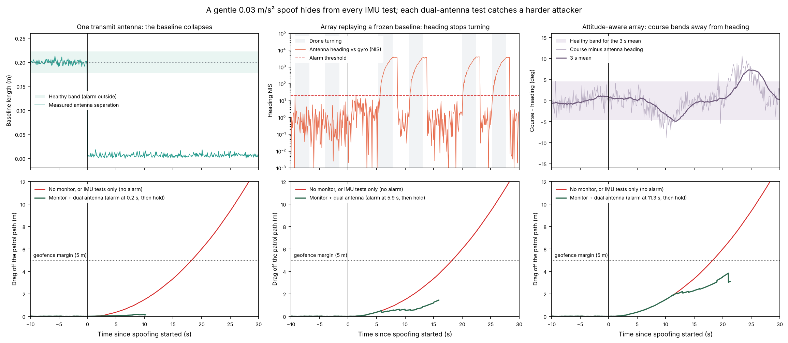
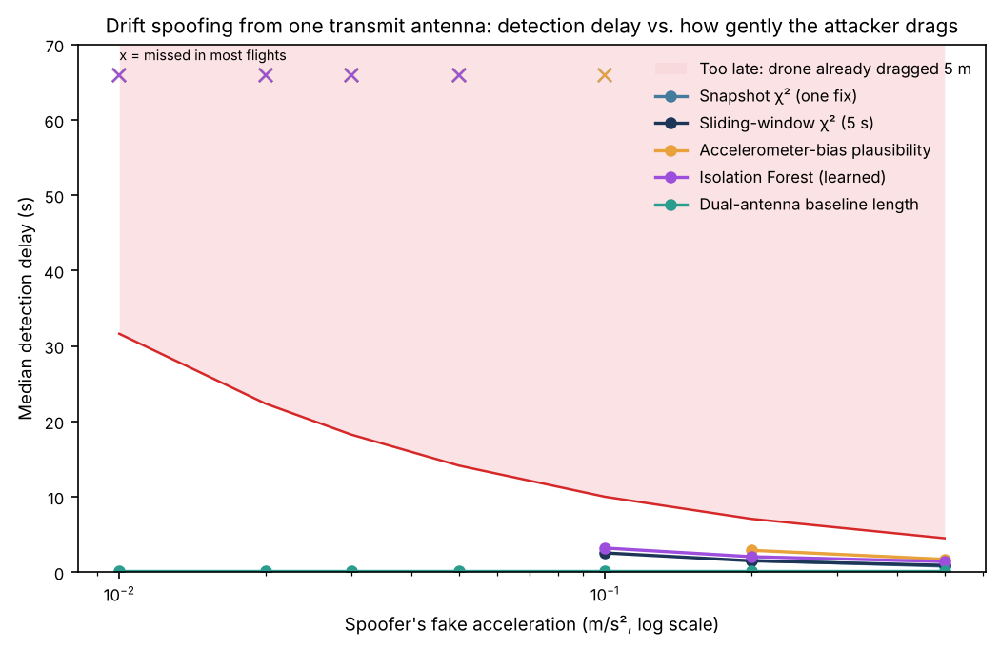

# GNSS Integrity Monitor for Small Drones

Detects when a drone's RTK position cannot be trusted (multipath, jamming, spoofing) and cuts GNSS out of the loop before the drone is dragged off course. The monitor is written twice, in Python for the benchmark and in C++ for ROS 2, and the two are tested to give the same answer on the same inputs.

Everything here is simulation or replay. No drone was flown and no receiver was spoofed.



## The problem

A drone on RTK-GNSS and an IMU can be wrong in ways the receiver does not report. Multipath shifts the solution while it still claims centimetres. Jamming removes it. A spoofer drags the reported position away gently, so no single fix looks like a jump, and a drone that trusts it flies wherever the attacker wants.

*Integrity* is a navigation system knowing when not to trust its own position. This project measures which tests catch which fault, how fast, how much of the flight they save, and where each test stops working.

## The main result: what a second antenna buys

GNSS and IMU consistency tests have a floor. A spoofer whose fake acceleration stays under about 0.05 m/s² hides inside a consumer accelerometer's own error (turn-on bias plus tilt, about 0.025 m/s² 1σ). The filter explains the fake motion as accelerometer bias and no inertial test sees it.

A second antenna 0.20 m from the first gives three more tests, at 0.20 m because that is the baseline a compact dual-input RTK receiver is built for. Each one catches an attacker the previous one cannot.

| The spoofer | What gives it away | Test | Detected | Delay, median (range) | Drag, unprotected → protected |
|---|---|---|---|---|---|
| One transmit antenna, gentle drift (0.03 m/s²) | Every signal arrives from one direction, so the measured antenna separation collapses | Baseline length | 10/10 | 0.2 s | 13.5 m → 0.6 m |
| Array that replays a frozen baseline | The antenna heading stops following the gyro at the next turn | Heading vs gyro | 10/10 | 2.2 s (0.5–5.9 s) | 13.5 m → 0.9 m |
| Array that tracks the drone's attitude | The drone starts moving sideways relative to where its nose points | Course vs heading, 3 s mean | 10/10 | 17.3 s (11.3–25.4 s) | 13.5 m → 6.3 m |

The four inertial tests (snapshot χ², 5 s window χ², accelerometer-bias plausibility, Isolation Forest) detected 0/10 of all three.

Read the last row honestly: the attitude-aware array is detected on every flight, and the drag is roughly halved, but 7 of 10 flights still pass the 5 m geofence margin before the alarm. A drag along the direction of travel does not turn the course at all, so this test waits for the route to turn. Closing that gap needs a reference the attacker cannot reach, such as visual-inertial odometry.

False alarms from the three dual-antenna tests over 2.0 h of unseen clean and honestly degraded flight: 0.

## All results (10 flights per scenario)

Regenerated by `python run_demo.py`; the full tables are in [results/results.md](results/results.md).

**Detection within 60 s, median delay**

| Scenario | Snapshot χ² | 5 s window χ² | Accel-bias | Isolation Forest | Baseline length |
|---|---|---|---|---|---|
| Clean flight | 0/10 false alarms | 0/10 | 0/10 | 0/10 | 0/10 |
| Honest RTK float (receiver reports 0.3 m) | 0/10 false alarms | 0/10 | 0/10 | 0/10 | 0/10 |
| Multipath step (1.5 m, 10 s) | 10/10, 0.0 s | 10/10, 0.0 s | 10/10, 0.1 s | 10/10, 0.2 s | 10/10, 0.2 s |
| Crude spoof (8 m jump) | 10/10, 0.0 s | 10/10, 0.0 s | 10/10, 0.0 s | 10/10, 0.2 s | 10/10, 0.2 s |
| Drift spoof, aggressive (0.2 m/s²) | 10/10, 1.6 s | 10/10, 1.5 s | 10/10, 2.9 s | 10/10, 2.1 s | 10/10, 0.2 s |
| Drift spoof, moderate (0.1 m/s²) | 2/10, 22.4 s | 10/10, 2.6 s | 3/10, 4.5 s | 9/10, 3.2 s | 10/10, 0.2 s |
| Drift spoof, gentle (0.03 m/s²) | 0/10 | 0/10 | 0/10 | 0/10 | 10/10, 0.2 s |

**Outcome with the monitor in the loop (median position error)**

| Scenario | No monitor | Inertial tests only | With the dual-antenna tests | Flights past the 5 m margin: none → inertial → dual |
|---|---|---|---|---|
| Multipath step | 2.0 m | 1.6 m | 0.7 m | 0/10 → 0/10 → 0/10 |
| Jamming (20 s outage) | 3.5 m | 3.5 m | 3.5 m | 1/10 → 1/10 → 1/10 |
| Crude spoof | 10.5 m | 1.0 m | 0.7 m | 10/10 → 0/10 → 0/10 |
| Drift spoof, aggressive | 50.0 m | 1.0 m | 0.6 m | 10/10 → 0/10 → 0/10 |
| Drift spoof, moderate | 40.0 m | 1.3 m | 0.6 m | 10/10 → 0/10 → 0/10 |
| Drift spoof, gentle | 13.5 m | 13.5 m | 0.6 m | 10/10 → 10/10 → 0/10 |

With a perfect tracking controller, the navigation error is how far the drone is physically dragged: it flies to keep its estimate on the patrol path. False alarms per hour over 2.0 h: 0.50 for the snapshot test, 0 for every other test.



## Findings

1. **Inertial tests turn a 10–50 m drag into about 1 m, down to a floor.** Crude, aggressive and moderate spoofers are caught in 0–3 s and no protected flight crossed the margin. Below about 0.05 m/s² the same tests detect nothing, the learned one included. That floor is the accelerometer, not the tuning.
2. **The baseline-length test has no such floor against one transmitter.** It detected 100% of drift spoofs from 0.01 to 0.5 m/s² in 0.2 s, because it tests geometry and not motion.
3. **Each dual-antenna test names an attacker.** Collapsed baseline: one transmitter. Heading leaves the gyro: replayed baseline. Course leaves the nose: attitude-aware array. An operator gets a reason, not only an alarm.
4. **Alarms from a baseline-faking attacker must latch.** A replayed baseline looks healthy every time the drone flies the heading the spoofer froze. Early versions trusted GNSS again after 3 s of agreement and the error jumped back to the unprotected value. The monitor now holds a course alarm until something outside it clears it.
5. **Heading helps the coast, not only the alarm.** After a course alarm the antenna heading is still good, so it is used as a nose-first constraint on the IMU-only velocity. With it the attitude-aware drag ends at 6.3 m against 13.5 m unprotected.
6. **The learned detector matched the best physics test and did not beat it.** The Isolation Forest, trained with no attack data, caught 9/10 moderate spoofs against 10/10 for the window test.
7. **An anomaly is not an attack.** Honest RTK float looked anomalous to the learned detector until window tests and learned scoring were limited to fixes that claim RTK-fixed precision, which is what every spoofer claims.
8. **Fixes before an alarm are already suspect.** Coasting from the filter's state at alarm time kept the spoofer's influence. Restoring the state from 3 s earlier and replaying the IMU cut 7–9 m to about 1 m.

## How a robotics team could use this

- **A regression harness for an integrity monitor.** `gim/faults.py` injects each fault into a flight and `run_demo.py` scores any detector on detection rate, delay, false alarms per hour and metres of drag. Change a threshold or add a test and the table shows what it cost.
- **A drop-in ROS 2 node.** `ros2/gim_monitor` sits between the receiver and the navigation filter and publishes one boolean, `/gim/gnss_trusted`, plus the reason and the statistics on `/diagnostics`. The tests live in one header with no ROS in it, so the same code can run in a flight-stack module.
- **Log triage.** `ros2 run gim_monitor replay < flight.txt` runs a recorded flight through the tests offline and prints every statistic per epoch.

## Interfaces

The node works in east-north-up, with angles from east towards north.

| Topic | Type | Meaning | PX4 uORB source |
|---|---|---|---|
| `/gim/baseline` | `geometry_msgs/Vector3Stamped` | Primary to secondary antenna (m) | `sensor_gnss_relative.position` (NED), valid when `carrier_solution_fixed` |
| `/gim/imu` | `sensor_msgs/Imu` | Yaw rate in `angular_velocity.z` | `sensor_combined.gyro_rad` |
| `/gim/velocity` | `geometry_msgs/TwistWithCovarianceStamped` | Navigation filter velocity and covariance | `vehicle_local_position.vx, vy` |
| `/gim/expected_drift` | `std_msgs/Float64` | Commanded heading minus course (rad), when not flying nose-first | yaw setpoint |
| `/gim/gnss_trusted` | `std_msgs/Bool` | Out: false means do not fuse GNSS | |
| `/gim/alarm_source` | `std_msgs/String` | Out: `baseline`, `heading` or `course` | |
| `/diagnostics` | `diagnostic_msgs/DiagnosticArray` | Out: every statistic behind the decision | |
| `/gim/reset` | `std_srvs/Trigger` | Trust GNSS again | |

The node only ever takes trust away. It sees no position, so it cannot tell a spoofer that went quiet from one that got better; the navigation filter owns the decision to trust again and calls `/gim/reset`.

Wiring it to PX4 over uXRCE-DDS is not done yet. PX4 v1.14.3 SITL starts the DDS client by default and already publishes `sensor_combined`, `vehicle_local_position` and `vehicle_gps_position`. `sensor_gnss_relative` is not in the default `dds_topics.yaml`, so it needs one line added there, and PX4 reports in north-east-down, so heading and yaw rate change sign on the way.

## What was checked, and what each check proves

| Check | Command | It proves | It does not prove |
|---|---|---|---|
| Unit tests | `pytest -q` | 21 tests: kinematics, filter consistency, each detector, protection, and C++ equal to Python on four flights to 6 digits | Anything about real hardware |
| ROS 2 replay | `bash run_on_construct.sh` | The C++ node, over its real topics, raises the same alarm at the same epoch as Python on four simulated flights | Behaviour on a real antenna pair |
| PX4 SITL | `bash run_px4.sh` | On telemetry from PX4 v1.14.3 the node stays quiet for 50 epochs, then raises a course alarm at a 0.70 rad course–yaw offset. The frame conversions are right | The baseline test. PX4 SITL has one antenna, so the baseline is built from PX4's yaw |

Saved output of the runs that passed: [results/logs](results/logs).

```text
clean: 700 epochs, GNSS trusted throughout (Python: no alarm)
single_transmitter: baseline alarm at 20.2 s, 0.2 s after the attack began (Python: baseline at 20.2 s)
frozen_baseline: heading alarm at 21.9 s, 1.9 s after the attack began (Python: heading at 21.9 s)
attitude_aware: course alarm at 38.9 s, 18.9 s after the attack began (Python: course at 38.9 s)
PASSED
```

The ROS check also counts `data/log.nmea`, a public UAV recording from 2011 ([source](data/SOURCE.md)). It has ordinary GPS and DGPS, no RTK and no second antenna, so no detector is applied to it.

## Run it

```bash
pip install -r requirements.txt
pytest -q                     # 21 tests, about half a minute (6 need g++)
python run_demo.py            # about 3 minutes on 2 cores, rewrites results/
python -m gim.export          # rewrites the flights the C++ node replays
bash run_on_construct.sh      # ROS 2 Humble: builds the C++ node and replays four flights
bash run_px4.sh               # ROS 2 Humble: builds PX4 v1.14.3 the first time (about 20 minutes)
```

## What's inside

| Path | What it does |
|---|---|
| `gim/flight.py` | Patrol laps at 5 m/s, 5 m inside a 60 × 40 m property |
| `gim/sensors.py` | Consumer-MEMS accelerometer (bias, bias walk, tilt leak, scale factor, noise) and a 10 Hz RTK receiver |
| `gim/dual_antenna.py` | Moving-base baseline (0.20 m, 5 mm per axis, so 1.4° of heading noise), yaw gyro, and the three tests |
| `gim/faults.py` | Multipath, honest float, jamming, jump and drift spoofing, and the three spoofer geometries |
| `gim/filter.py` | Loosely coupled GNSS/INS Kalman filter `[position, velocity, accel bias]`, tuned until clean-flight NIS averages 2.06 (theory 2.0) |
| `gim/detectors.py` | The seven tests and the online monitor |
| `gim/sim.py` | Flight runner. On an alarm: stop fusing GNSS, rewind the filter, coast on the IMU |
| `ros2/gim_monitor` | C++17: `dual_antenna.hpp` (no ROS), the ROS 2 node, and a command-line replay tool |
| `docs/fleet-rtk-health.md` | Design note: aggregating these alarms across a fleet |

## Limitations

- Simulation only. The 5 mm baseline noise is an assumption for a fixed moving-base solution at 0.20 m, not a measurement of a receiver. Receiver vendors describe headings from baselines under about 0.5 m as usable but noisy, and the 1.4° here stands for that.
- The spoofer geometries are models. A real array has its own errors, and an attacker who also watches the monitor is not modelled.
- The course test assumes the drone flies nose-first or reports its commanded drift angle. It has a 1° budget for sideslip. A fixed-wing in crosswind needs a wind estimate first.
- 2-D horizontal navigation with attitude assumed known; loosely coupled, so no pseudorange-level RAIM.
- One property and one trajectory, with consumer-MEMS parameters that are plausible but not calibrated to a part.

## Next

1. Subscribe to `px4_msgs` over uXRCE-DDS in place of the MAVLink bridge the PX4 check uses.
2. A real moving-base log (u-blox `UBX-NAV-RELPOSNED` or PX4 `sensor_gnss_relative`) to replace the assumed baseline noise.
3. A visual-inertial cross-check for the along-track drag the course test cannot see.

## References

- P. D. Groves, *Principles of GNSS, Inertial, and Multisensor Integrated Navigation Systems*
- Y. Bar-Shalom, X. R. Li, T. Kirubarajan, *Estimation with Applications to Tracking and Navigation*
- F. T. Liu, K. M. Ting, Z.-H. Zhou, "Isolation Forest," *ICDM*, 2008
- PX4 documentation: EKF2 innovation checks, uXRCE-DDS, `SensorGnssRelative`

---
Developed with AI pair-programming assistance. MIT licensed.
