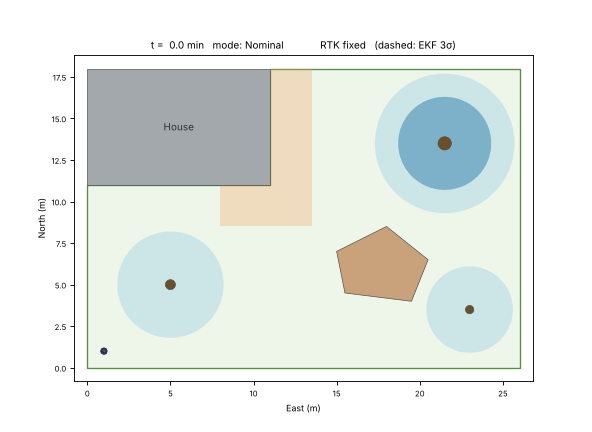
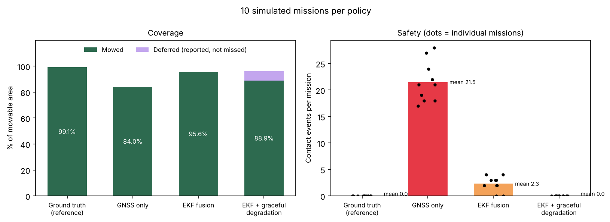
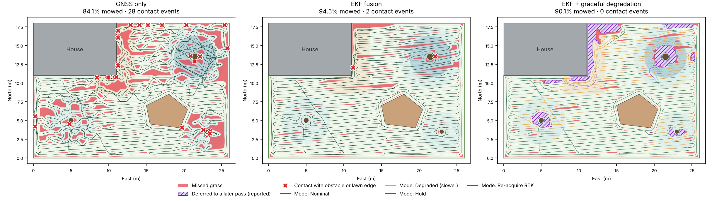
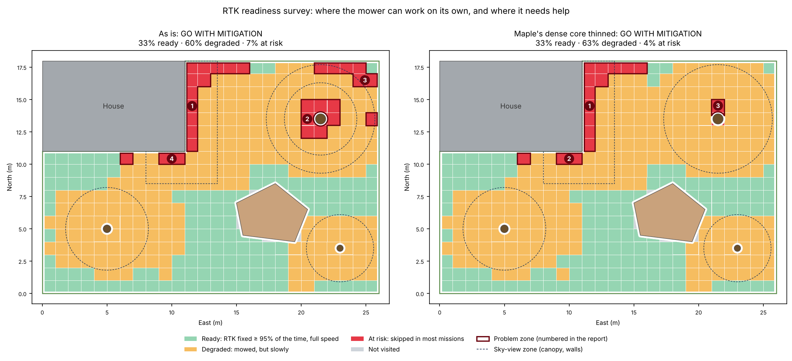
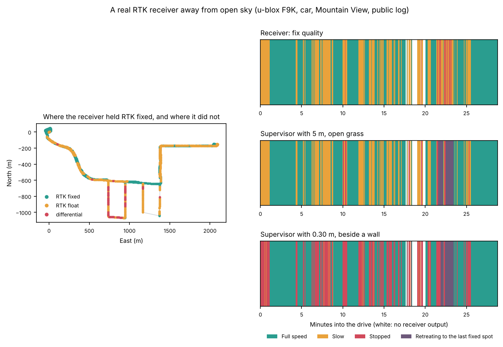

# RTK-Resilient Autonomous Mower

Coverage planning, RTK-GNSS / IMU / wheel-odometry fusion, and a supervisor that keeps an autonomous mower safe and productive where RTK fails: under trees and next to buildings. The supervisor is written in Python for the simulation and in C++ for ROS 2, and the two are tested to give the same answer on the same inputs.

The missions are simulated. The receiver log is real, from a car. The ROS 2 checks run in Gazebo. No mower was built.



## The problem

RTK gives centimetre positioning only under open sky. A yard does not offer that everywhere:

- **Under tree canopy** the receiver drops from RTK fixed (about 2 cm) to float (decimetres, with a slowly drifting bias) or loses the solution.
- **Next to walls**, reflected signals bias the solution, typically away from the wall, which is the error that steers a mower into it.
- **After every outage**, the receiver needs several seconds of open sky to fix again.

A mower that trusts a degraded fix cuts into flower beds and scrapes trunks. A mower that stops whenever RTK degrades never finishes. This project makes that trade-off explicit and measurable.

## Result 1: zero contact, and the grass it could not mow is reported

10 simulated missions per policy on a 390 m² L-shaped yard with a house, trees and a flower bed.



| Policy | Mowed (%) | Deferred, reported (%) | Contact events / mission | Missions with contact | P95 position error (m) | Mission time (min) |
|---|---|---|---|---|---|---|
| Ground-truth pose (reference) | 99.1 (99.1–99.2) | 0.0 | 0.0 | 0 / 10 | 0.00 | 42 (42–42) |
| GNSS only | 84.0 (83.0–85.3) | 0.0 | 21.5 (17–28) | 10 / 10 | 1.05 (0.79–1.79) | 60 (58–61) |
| EKF fusion | 95.6 (94.5–96.1) | 0.0 | 2.3 (0–4) | 8 / 10 | 0.23 (0.20–0.31) | 44 (44–44) |
| **EKF + graceful degradation** | 88.9 (86.2–90.5) | 7.3 (6.1–9.4) | **0.0 (0–0)** | **0 / 10** | 0.24 (0.21–0.30) | 55 (53–62) |

*Mean (min–max). A contact event means the robot's 0.25 m footprint touched an obstacle or crossed the lawn edge.*

- **GNSS only** steers straight from receiver output: 16% of the lawn is missed and it touches obstacles about 21 times per mission.
- **EKF fusion** mows 95.6% but still touches the maple trunk or the house corner in 8 of 10 missions. Dead reckoning under canopy is good enough for open grass, not for passing 15 cm from a trunk.
- **EKF + graceful degradation** had zero contact events in all 10 missions. It mows 88.9% and reports another 7.3% as deferred. The cost is about 25% more mission time.



## Result 2: a site survey that says where RTK will not be enough

`python survey.py` turns the same missions into the report an installer needs before the first mow: where the mower runs at full speed, where it slows, where it gives up, why, and what would fix each spot.



| Yard | Verdict | Ready | Degraded | At risk | Mission time |
|---|---|---|---|---|---|
| As is | GO WITH MITIGATION | 32.7% | 59.9% | 7.3% (26 m²) | 55 min, against 42 min with perfect positioning |
| Maple's dense core thinned | GO WITH MITIGATION | 33.2% | 62.8% | 3.9% (14 m²) | 53 min |

The largest problem zone is 10.2 m² along the two-storey walls (wall reflections). The second is 7.1 m² under the maple's dense core (no RTK solution at all), and thinning the canopy removes it. Each zone in [results/readiness.md](results/readiness.md) comes with a cause and a fix: a wider wall margin, a camera for the last strip, a pruned canopy, or a lane plan that exits degraded zones into open lawn.

## Result 3: a real receiver loses its fix often, and for a long time

The simulated yard assumes float episodes of several seconds. A public u-blox F9K log (a car in Mountain View, from Google's gps-measurement-tools) shows what a real RTK receiver does away from open sky:



- 1,653 readings over 29 minutes and about 8.6 km: 967 RTK fixed, 632 float, 54 differential. Fixed for 58% of them.
- The fixed solution was lost **69 times**. Half of the losses were over within 4 s. **19 lasted longer than 10 s**, the time the supervisor waits before giving up on a spot, and the longest lasted 73 s.

Replaying that quality sequence through the supervisor, with 2 cm assumed for fixed, 15 cm for float and 50 cm for differential:

| Room around the mower | Full speed | Slow | Stopped | Retreating to the last fixed spot |
|---|---|---|---|---|
| 5 m, open grass | 967 | 527 | 65 | 94 |
| 0.30 m, beside a wall | 967 | 32 | 574 | 80 |

The same receiver output is safe to keep working on in one place and not in the other. That is why the stop rule depends on clearance and not on the fix type alone. Details: [results/real_gps.md](results/real_gps.md).

## How the degradation logic works

The acceptable position uncertainty depends on where the robot is:

```
sigma_limit = clip(clearance_to_nearest_hazard / 3,  5 cm,  25 cm)
```

In open grass a float fix or a stretch of dead reckoning is fine. Next to a trunk it is not. Clearance is measured from the robot's body, at the robot and along the next metre of planned path.

| State | Trigger | Action |
|---|---|---|
| NOMINAL | RTK fixed and σ < 4 cm | Full speed (0.5 m/s) |
| DEGRADED | Float or no fix, σ within the limit | Speed scales from 0.5 down to 0.2 m/s as σ approaches the limit |
| HOLD | 3σ > clearance | Stop. At rest, uncertainty stops growing. Wait up to 10 s for RTK |
| SKIP *(event)* | Hold timed out, not lost | Defer the strip next to the hazard and re-route |
| RETREAT | Lost (σ ≥ 25 cm), or the mission layer asks | Drive to the last spot with a fixed solution at 0.3 m/s, resume once fixed |

This is the same pattern as a circuit breaker in a distributed system (closed, half-open, open, fallback), applied to positioning.

Design notes that matter on real robots:

- **Float error is not white noise.** It is modelled as two Gauss-Markov bias states, so a stream of float fixes cannot make the filter overconfident.
- **Gate outliers, but not forever.** The filter reopens its covariance only when rejected fixes agree with each other, never for scattered jumps.
- **Learn slip while RTK is good.** The odometry-scale state calibrates grass slip online, which keeps dead reckoning under canopy usable.
- **Stopping is a sensing strategy.** A stationary robot's uncertainty stops growing, so holding near a hazard is safe while it waits.

## The supervisor in ROS 2

`ros2/mower_supervisor_cpp` is the supervisor as a C++ node. `supervisor.cpp` has no ROS in it.

| Topic | Type | Meaning | Where it comes from on a robot |
|---|---|---|---|
| `/gnss/fix` | `sensor_msgs/NavSatFix` | 1-sigma error, from the larger of the east and north variances | Any GNSS driver |
| `/gnss/rtk_quality` | `std_msgs/UInt8` | NMEA GGA quality: 4 fixed, 5 float. Optional | GGA field 6; PX4 `sensor_gps.fix_type` (6 fixed, 5 float) |
| `/hazard_clearance` | `std_msgs/Float64` | Free space from the body to the nearest hazard (m) | A distance grid of the map, or the costmap |
| `/mower/command` | `std_msgs/String` | `retreat`, from the mission layer | |
| `/mower/speed_limit` | `std_msgs/Float64` | Out: m/s, forwarded to Nav2 as `nav2_msgs/SpeedLimit` | |
| `/mower/mode` | `std_msgs/String` | Out: NOMINAL, DEGRADED, HOLD or RETREAT | |
| `/mower/event` | `std_msgs/String` | Out: `skip` when a hold has timed out | |

Two details that only show up when this meets real drivers:

- **`NavSatStatus` cannot tell RTK fixed from RTK float.** Drivers report both as `GBAS_FIX`. The node takes the receiver's own quality code on `/gnss/rtk_quality` when it is there. The Gazebo check includes a float reading that a driver labels `GBAS_FIX` with a 3 cm covariance: the supervisor slows to 0.46 m/s where the status alone would have allowed full speed.
- **Nav2 has no zero speed limit.** `nav2_msgs/SpeedLimit` reads 0 as "no limit", and a crawl is not a stop. On HOLD the mission layer cancels the `FollowPath` action, so the controller commands zero.

### What the Nav2 run did

`bash run_nav2.sh` starts the Gazebo yard, Nav2's controller server with Regulated Pure Pursuit, and the C++ supervisor. The mower drives a lane under a canopy and on towards a wall:

```text
open grass: mode NOMINAL, speed limit 0.50, Nav2 command 0.50
under a tree: mode DEGRADED, speed limit 0.32, Nav2 command 0.32
next to a wall: mode HOLD, path cancelled, Nav2 command 0.00, mower moved 0.0 cm in 10 s
hold timed out: strip by the wall given up, supervisor told to retreat
retreat: mode RETREAT, speed limit 0.30, Nav2 command 0.30, driving away from the wall
back in open grass: mode NOMINAL at x = 18.9 m
closest the mower body came to the wall: 0.53 m
PASSED
```

GPS quality in Gazebo is scripted from the pose (open grass fixed, canopy float, wall worse). It is not a sensor model, and the robot is a kinematic body with no wheel slip.

## How a robotics team could use this

- **A safety layer between localization and Nav2.** The node needs three inputs any RTK robot already has and gives the controller a speed limit, a stop and a reason.
- **A pre-install site survey.** `survey.py` and `mower/readiness.py` turn missions, simulated here and logged in the field later, into a go / no-go report with the square metres at risk and a fix per zone.
- **Field-log triage.** `python -m mower.replay_nmea your.nmea --write` reports how often a receiver lost its fix, for how long, and what the supervisor would have done. `ros2 run mower_supervisor_cpp replay` does the replay with the C++ build.
- **A regression test for the supervisor.** `tests/test_cpp_parity.py` holds the C++ and Python supervisors to the same answer on the 1,653 real readings and on 20,000 random ones.

## What was checked, and what each check proves

| Check | Command | It proves | It does not prove |
|---|---|---|---|
| Unit tests | `pytest -q` | 25 tests: planner, EKF, GNSS model, supervisor, site survey, real-log replay, and C++ equal to Python | Anything about real hardware |
| Gazebo, C++ node | `bash run_on_construct.sh` | The node gives the Python supervisor's answer at five places in a Gazebo yard, over its real topics | Driving: the mower is placed, not driven |
| Gazebo + Nav2 | `bash run_nav2.sh` | The full loop above: slow, true stop, skip, retreat, recover, 0.53 m from the wall | Real GNSS, wheel slip, a real controller tune |
| Python node | `docker build -f ros2/Dockerfile -t mower-supervisor . && docker run --rm mower-supervisor` | The Python node gives the same answers on ROS 2 Jazzy | |

Saved output of the runs that passed: [results/logs](results/logs).

## Run it

```bash
pip install -r requirements.txt
pytest -q                               # 25 tests, a few seconds (3 need g++)
python run_demo.py --gif                # 40 missions, about 4 minutes on 2 cores, writes results/
python survey.py                        # site survey, about 1 minute, writes results/readiness.*
python -m mower.replay_nmea --write     # real receiver log, writes results/real_gps.*
bash run_on_construct.sh                # ROS 2 Humble + Gazebo Classic: C++ node at five places
bash run_nav2.sh                        # ROS 2 Humble + Gazebo Classic + Nav2: the full loop
```

## What's inside

| Path | What it does |
|---|---|
| `mower/planner.py` | Complete-coverage planning: headland loops, boustrophedon swaths at the sweep angle with the fewest turns, greedy ordering, obstacle-free transits on a visibility graph |
| `mower/gnss.py` | RTK receiver model: fix quality driven by sky view, correlated float bias, multipath push and outlier jumps near walls, re-convergence delay |
| `mower/robot.py` | Differential-drive mower on turf: wheel slip, side-slip and yaw disturbances that encoders cannot see; biased, noisy gyro |
| `mower/ekf.py` | 7-state EKF `[x, y, heading, gyro_bias, odom_scale, float_bias_x, float_bias_y]` with chi-square gating and online slip calibration |
| `mower/supervisor.py` | The supervisor above |
| `mower/readiness.py`, `survey.py` | Site survey: 1 m cells classified ready, degraded or at risk, with causes and fixes |
| `mower/replay_nmea.py` | Real receiver log: fix-loss statistics and the supervisor's answer |
| `mower/sim.py` | Mission runner, deferral and re-routing, scoring |
| `ros2/mower_supervisor_cpp` | C++17 supervisor, ROS 2 node, and a command-line replay tool |
| `ros2/mower_yard` | Gazebo world, the placement check and the Nav2 mission script |
| `ros2/mower_supervisor` | The Python node and its check |

## Limitations

- 2-D, flat yard: no slopes, and no antenna tilt from pitch and roll.
- Statistical GNSS model driven by sky-view zones, not satellite-level simulation. The zones are known to the simulator, not to the robot.
- Obstacles come from a known map. A real mower also needs bump or vision sensing for unmapped obstacles.
- The Mountain View log is a real receiver on a car. It has no tree or wall labels and no error in metres, so the clearances and the 2 cm / 15 cm / 50 cm errors are assumed.
- The site survey is built from simulated missions. On a real site it would be built from a walk-around or first-mow log.

## Next

1. Filtered odometry from `robot_localization` in the Gazebo yard, so the node's sigma comes from an estimator and not from a script.
2. The site survey from a field log: positions and fix quality from a walk-around, in place of simulated missions.
3. Deferred-zone scheduling: retry deferred strips later, when satellite geometry has changed.
4. Vision for the last 30 cm, where RTK cannot help (walls, trunks).

## References

- Nav2 documentation: Regulated Pure Pursuit, speed limits, GPS navigation tutorial, `robot_localization` setup guide
- G. Mier, J. Valente, S. de Bruin, "Fields2Cover: An Open-Source Coverage Path Planning Library for Unmanned Agricultural Vehicles," *IEEE RA-L*, 2023
- OpenMower, an open-source RTK-GPS robotic mower (reference architecture)
- S. Thrun, W. Burgard, D. Fox, *Probabilistic Robotics*
- P. D. Groves, *Principles of GNSS, Inertial, and Multisensor Integrated Navigation Systems*

---
Developed with AI pair-programming assistance. MIT licensed.
