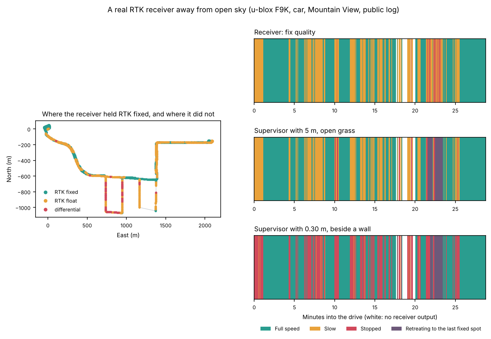

# Real receiver replay

File: `data/MTV.Local1.ublox-F9K.20200206-181434.nmea`

Source: a u-blox F9K on a car in Mountain View, 6 February 2020, published in Google's gps-measurement-tools.

https://github.com/google/gps-measurement-tools/blob/master/NmeaUtils/example/MTV.Local1.ublox-F9K.20200206-181434.nmea

This is a car on public roads, not a mower in a yard. It is here because it is a real RTK receiver leaving open sky, which the simulated yard can only assume.

## What the receiver did

1,653 readings over 29 minutes and about 8.6 km. The receiver reported 967 RTK fixed, 632 RTK float and 54 differential readings, so it held a fixed solution for 58% of them.

It lost the fixed solution 69 times. Half of the losses were over within 4 s. 19 of them lasted longer than the 10 s the supervisor waits before it gives up on a spot, and the longest lasted 73 s. Those long losses add up to 8.9 minutes of the drive. The longest silence, with no output at all, was 40 s.

## What the supervisor does with it

The file does not label trees or walls, and it does not give the error in metres. The replay uses 2 cm for a fixed reading, 15 cm for a float reading and 50 cm for a differential reading. The gap to a hazard is then assumed in two ways.

| Room around the mower | Full speed | Slow | Stopped | Retreating to the last fixed spot |
|---|---|---|---|---|
| 5 m, open grass | 967 | 527 | 65 | 94 |
| 0.30 m, beside a wall | 967 | 32 | 574 | 80 |

Each row adds up to 1,653 readings. Every fixed reading runs at full speed. With 5 m of room most float readings only slow the mower; with 30 cm of room they stop it. The same receiver output is safe to keep working on in one place and not in the other, which is why the stop rule depends on the clearance and not on the fix type alone.
